# Tailglow: open-source settings for Keychron mice on Linux

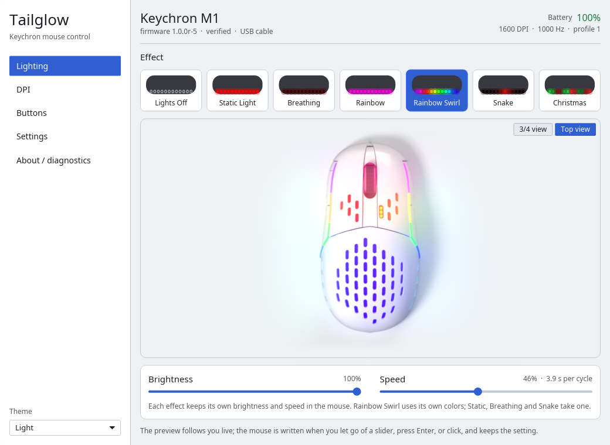
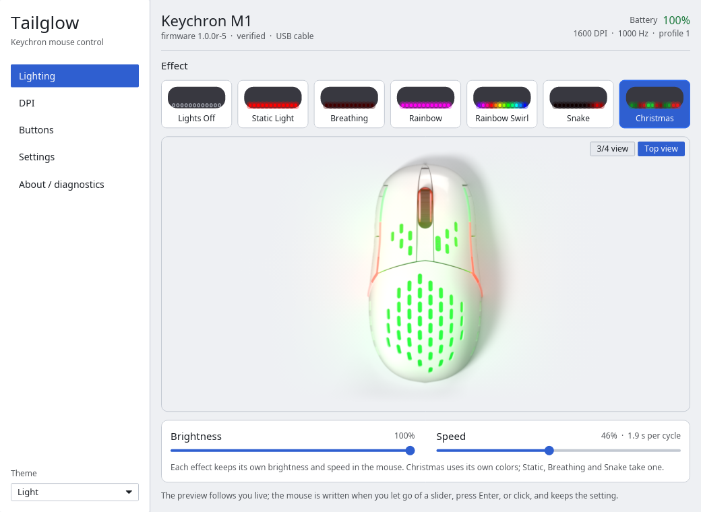

Lighting, DPI, report rate, sensor options, button remapping and battery
status for Keychron mice, without the vendor's Windows app.

*Tailglow is not affiliated with or endorsed by Keychron. Keychron is a
trademark of its owner.*

Written in Rust:

- `tailglow-core`: the protocol, device table, safe value ranges and the
  settings-file schema (no I/O);
- `tailglow`: command-line tool;
- `tailglow-gui`: desktop app built with iced;
- `tailglow-tray`: tray icon (Linux) with battery, connection and quick
  settings;
- `tailglow-hid`: Linux hidraw transport (no libudev), a hidapi transport for
  Windows and macOS, a `FakeMouse` that replays recorded USB captures for
  tests, and read-only Bluetooth status from BlueZ.

**Platforms:** Tailglow is a **Linux** project. Keychron already makes apps for
Windows and macOS; this one exists so Linux users (desktop and gaming distros
alike) get the same control. Some code paths still compile elsewhere through
hidapi, but only Linux is built, tested and supported.

Everything here is clean-room work: the protocol was learned from our own USB
captures of **Keychron Mouse 1.2.1.2 for Windows** driving a Keychron M1 in a
VM. No vendor code was read or copied. See `docs/PROTOCOL.md`.

Repository: https://github.com/CyberJody/tailglow
App id: `io.github.cyberjody.Tailglow`.

**License:** GPL-3.0-or-later (see `LICENSE`).

## Supported mice

Status tags: *verified* = tested on the hardware, every setting read back and
lighting confirmed with a webcam; *likely* = same vendor app and same settings
interface as the M1, so it should work, but no owner has confirmed it yet.

**Tested by** names who confirmed a model on real hardware. A confirmed
report from an owner (reads, then writes read back with `tailglow`) moves a
model from *likely* to *verified*: please use the [mouse report form](https://github.com/CyberJody/tailglow/issues/new?template=mouse-report.yml).

| Model | USB ID | Interface | Status | Tested by |
|---|---|---|---|---|
| Keychron M1 (wired) | 3434:d035 | 2 | **verified** (firmware 1.0.0r-5) | project author |
| Keychron M3 | 3434:d032, 3434:d033 | 2 | likely, untested |  |
| Keychron M3 mini | 3434:d036, 3434:d03e | 2 | likely, untested |  |
| Keychron M2 | 3434:d03b | 2 | likely, untested |  |
| Keychron M2 mini | 3434:d03d | 2 | likely, untested |  |
| Keychron M6 | 3434:d03f | 2 | likely, untested |  |
| Keychron M7 | 3434:d044 | 2 | likely, untested |  |
| Keychron 2.4 GHz receiver (Type-C / Type-A) | 3434:d031 / 3434:d030 | 1 | likely, untested |  |

- **Verified:** only the Keychron M1 wired over its cable. All features below
  were exercised on it (`scripts/hw-test.sh`: 43 of 43 steps passed).
- **Bluetooth:** the M1 over Bluetooth shows its connection and battery level
  (read from BlueZ). Settings need the cable: see "Bluetooth" below.
- **Likely, untested:** the vendor app's own configuration lists these models
  under the same vendor interface (MI_02, receivers MI_01) as the M1, so the
  protocol is probably shared, but nobody has captured one. Reads work without
  any flag. Writes are refused unless you pass `--allow-untested` (CLI) or
  tick the matching checkbox (GUI). If you own one, please report what
  happens with the [mouse report form](https://github.com/CyberJody/tailglow/issues/new?template=mouse-report.yml);
  `docs/ADD-YOUR-MOUSE.md` explains how to go further (capture and verify).
- **Don't see your mouse?** Keychron makes more models than are listed here, and
  we're adding them as owners test them. Please tell us about yours with the
  [mouse report form](https://github.com/CyberJody/tailglow/issues/new?template=mouse-report.yml) (pick "Other"): the `lsusb` line (3434:xxxx) and
  the output of `tailglow list` are all we need to start. Watch or star the repo
  to hear when it lands.

## Features

All of these are verified on the M1 (written and read back; lighting also
checked with a webcam):

- **Lighting:** 7 effects (off, static, breathing, rainbow, rainbow-swirl,
  snake, christmas); brightness 12-255; speed 20-255 with an approximate
  period shown (for example speed 128 is about a 3.8 s rainbow cycle);
  colour for static, breathing and snake. The mouse stores brightness, speed
  and colour per effect, and `tailglow` reads all of it back.
- **DPI:** 5 stages, 100-26000 in steps of 50, plus the active stage.
- **Report rate:** 125, 500 or 1000 Hz.
- **Sensor options:** lift-off 1 or 2 mm, ripple control, angle snapping,
  motion sync, scroll direction.
- **Debounce:** button debounce time in ms (vendor default 8). Only 8-11 ms
  were captured from the vendor app, so that is what tailglow writes by
  default; 1-30 ms need `--allow-untested` (GUI: the "Allow untested" box),
  because the mouse's real limits are unknown.
- **Button remapping** for every key and the scroll wheel: mouse buttons,
  keyboard shortcuts, media keys, DPI loop/up/down, lighting controls,
  auto-fire, system shortcuts (copy, paste, calculator, ...), disable, back to
  default. tailglow refuses to remove the last Left-Click: Key 1 can be
  remapped only after another key has been given Left-Click (the GUI shows
  the only Left-Click key as locked).
- **Macros (experimental):** single-report macros of at most 13 steps (key
  press, key release, delay), loop count / until-release / until-any-click,
  fixed delay. The mouse accepts them, but there is no command to read a
  macro back, and the mouse does not flag a macro key as remapped in its
  button-map read; `tailglow info` therefore cannot show one. tailglow
  remembers the macros it assigned in its state file (with a fingerprint of
  the exact reports sent), carries them into `export`, and does not re-send
  an unchanged macro on `import` / `watch` / tray profile switches. If a
  macro was cleared outside tailglow in a way the read-back cannot see, use
  `tailglow import --force`.
- **Resets:** buttons, lighting, or factory (all ask for `--yes`).
- **Settings files:** `export` / `import` of a versioned TOML file
  (`schema = 1`, sections `[device] [lighting] [dpi] [pointer] [buttons]
  [macros.keyN]`); `import` only writes what differs from the mouse, then
  reads the mouse back and fails if anything did not land. Values are checked
  when the file is read (DPI range and grid, debounce 1-30, brightness and
  speed floors), not only when they are sent.
- **Apply-on-plug:** `tailglow watch` waits for the mouse and re-applies the
  last saved settings whenever it appears; shipped as a systemd user unit.
- **GUI:** lighting, DPI, buttons and settings pages with live read-back,
  Open/Save of the same settings files, an About page.
- **Tray icon** (`tailglow-tray`): StatusNotifierItem on the session bus (pure
  Rust, `ksni`/`zbus`; works with Cinnamon's xapp status applet, KDE, Waybar
  and friends). Tooltip with model, battery, effect and DPI; a menu to switch
  the effect, pick a colour or the active DPI stage, re-apply the saved
  settings, open the GUI. The tooltip and menu say whether the mouse is on
  the USB cable or on Bluetooth (status only there). One desktop notification
  fires when the battery is at 15 % or lower, once per discharge (it re-arms
  after the mouse is charged to 25 %). Autostart with the shipped
  `tailglow-tray.desktop` or `systemctl --user enable --now tailglow-tray`.
- **Bluetooth status:** connection type (USB cable or Bluetooth) and battery
  level, live, in the CLI (`tailglow status`), the GUI header and the tray;
  old pairings can be listed and removed after a confirm. Details below.
- **Per-application profiles** (`tailglow-tray`, X11 only): the tray watches
  the active window's `WM_CLASS` through `x11rb` and applies the settings file
  mapped in `~/.config/tailglow/apps.toml`, writing only what differs from the
  mouse, at most once per 2 s:

      default = "~/.config/tailglow/profiles/desktop.toml"   # optional
      [apps]
      firefox = "~/.config/tailglow/profiles/browser.toml"
      "org.inkscape.Inkscape" = "~/.config/tailglow/profiles/drawing.toml"

  Keys match the window class or instance, case-insensitively
  (`tailglow-tray --dry-run` prints what it sees). Profiles are ordinary
  `tailglow export` files. On Wayland there is no portable active-window API, so
  this part switches itself off and says so; the rest of the tray still works.

Not supported, on purpose:

- **On-board profile switching.** `tailglow profile` shows the profile index
  the mouse reports (read-only). The vendor app's profile write carries a
  key-pairing byte that no read command returns, and the mouse's profile
  index never changed in any capture, so there is nothing safe to write and
  no evidence the mouse stores more than one profile.
- **Key-pairing combination.** Seen in the captures (tagged *likely*), not
  readable back; not implemented.
- **Firmware update.** Never. No firmware, bootloader or flash command was
  ever captured and none will be sent.
- **Software-driven effects** (clock colour, CPU temperature, music): deferred
  until we know whether lighting writes wear the mouse's flash. See
  `docs/SOFTWARE-EFFECTS.md`.

## Bluetooth

Keychron's firmware takes no settings over Bluetooth: the M1's Bluetooth HID
report map has no vendor reports, and Keychron's own app says settings are
"not supported in Bluetooth mode" (`docs/PROTOCOL.md` §11). So over Bluetooth
Tailglow shows **status only**:

- whether the mouse is connected over Bluetooth (BlueZ `org.bluez.Device1`
  named `keychron M1`, or modalias `usb:v3434pD035…`; the Bluetooth address
  is random and changes on every re-pair, so it is never used to recognise
  the mouse);
- its battery level (`org.bluez.Battery1`), updated live;
- in the GUI, the settings pages are read-only with the note "Settings can
  only be changed over the USB cable (Keychron's firmware doesn't support it
  over Bluetooth). Settings you save stay in the mouse.";
- the tray tooltip and menu show the Bluetooth battery; the low-battery
  notification works the same way.

Commands:

    tailglow status                       # USB cable / Bluetooth, battery, can settings be changed
    tailglow bluetooth                    # every Keychron pairing BlueZ knows
    tailglow bluetooth forget-stale       # list pairings that are not connected
    tailglow bluetooth forget-stale --yes # remove them (Adapter1.RemoveDevice)

Each re-pair of the M1 leaves an old entry behind. Removing one only edits
this computer's Bluetooth list (nothing is sent to the mouse) and needs an
explicit confirm (`--yes`, or the GUI's Settings page → "Remove old
pairings…" → "Confirm remove"); a connected mouse is never removed. A
sleeping mouse also shows as "not connected", so when no Keychron mouse is
connected Tailglow warns that one of the entries may be the current pairing.

Read-only by construction: the BlueZ code (`crates/tailglow-hid/src/bluez.rs`)
reads properties and listens for signals; the only method it can call besides
`GetManagedObjects` is the confirmed `RemoveDevice`. It never calls `Pair`,
`Connect`, `Disconnect` or any GATT characteristic method (the M1 has a
firmware-update characteristic). Unit tests scan that file for forbidden
calls, and integration tests run against a fake BlueZ on a private D-Bus that
records every call. Reading BlueZ needs no special permission.

`TAILGLOW_BLUEZ_BUS` chooses the bus: `system` (default), `off`, or a D-Bus
address (the tests and `scripts/bluetooth-screenshots.sh` use a fake BlueZ,
`cargo run -p tailglow-hid --example fake-bluez`). With the fake mouse
(`TAILGLOW_FAKE`) Bluetooth is off unless the variable is set.

## Install

Packages for the **AUR** (Arch, CachyOS, Manjaro) and **Flathub** (Mint,
Bazzite, SteamOS and others) are planned. Until then, build from source;
it takes a few minutes.

### Build from source

1. Install Rust with [rustup](https://rustup.rs) (stable).
2. Install the GUI's build dependencies (iced/winit: libxkbcommon, Wayland
   and X11 headers; the hidraw transport needs nothing beyond libc). On
   Debian, Ubuntu and Mint these are the packages CI uses:

       sudo apt install build-essential pkg-config libxkbcommon-dev libxkbcommon-x11-dev \
           libwayland-dev libx11-dev libxcb1-dev libxcb-render0-dev libxcb-shape0-dev libxcb-xfixes0-dev

   Other distributions: the equivalent development packages.
3. Build and test:

       git clone https://github.com/CyberJody/tailglow
       cd tailglow
       cargo build --release
       cargo test --workspace

   Binaries land in `target/release/tailglow`, `target/release/tailglow-gui`
   and `target/release/tailglow-tray`.
4. Install the udev rule (below) so your user can talk to the mouse, then
   unplug and replug it and run `target/release/tailglow info`. The rule
   covers the M1; for another model add its product id first (see below).

### Debian package

    cargo install cargo-deb
    cargo build --release
    cargo deb -p tailglow --no-build
    sudo apt install ./target/debian/tailglow_*.deb

The package `tailglow` installs the three binaries into `/usr/bin`, the udev
rule into `/usr/lib/udev/rules.d/`, the systemd user units (`tailglow-watch`,
`tailglow-tray`) into `/usr/lib/systemd/user/`, the desktop entries (GUI, and
an autostart entry for the tray) into `/usr/share/applications/` and
`/etc/xdg/autostart/`, the AppStream metainfo into `/usr/share/metainfo/`,
and this README into `/usr/share/doc/tailglow/`. The Debian `copyright` file
(DEP-5, GPL-3+) is `packaging/debian-copyright`.

### udev rule (Linux)

The mouse's vendor interface (USB interface 2 on the M1) is root-only by
default. `packaging/70-keychron-m1.rules` grants the logged-in desktop user
access to that interface only (pointer and keyboard interfaces stay
root-only). It is M1-only; add a line for your model when you verify one.

    sudo cp packaging/70-keychron-m1.rules /etc/udev/rules.d/
    sudo udevadm control --reload && sudo udevadm trigger
    # then unplug and replug the mouse

The .deb installs the rule for you; replugging is still needed.

### Apply-on-plug (systemd user unit)

`packaging/tailglow-watch.service` runs `tailglow watch`, which polls for the
mouse every 2 s and re-applies `~/.config/tailglow/state.toml` (the last
settings you applied with the CLI or GUI) whenever the mouse appears.

    # from source: copy it to ~/.config/systemd/user/ first; the .deb already installed it
    systemctl --user daemon-reload
    systemctl --user enable --now tailglow-watch

### Flatpak

`packaging/io.github.cyberjody.Tailglow.yml` is a Flatpak manifest
(org.freedesktop.Platform 24.08, rust-stable SDK extension, `--device=all`
for hidraw, `--system-talk-name=org.bluez` for Bluetooth status). It installs
the AppStream metainfo `packaging/io.github.cyberjody.Tailglow.metainfo.xml`
(validated with `appstreamcli validate`). It is **untested**: flatpak-builder was not available on the
machine it was written on, and the `cargo-sources.json` for the offline build
still has to be generated. The udev rule is still needed on the host.

### Desktop entry and icon

`packaging/icons/io.github.cyberjody.Tailglow.svg` (original artwork: a mouse in an RGB ring)
is installed by the .deb as
`/usr/share/icons/hicolor/scalable/apps/io.github.cyberjody.Tailglow.svg`; both desktop
entries use `Icon=io.github.cyberjody.Tailglow`, the GUI's desktop file is
`io.github.cyberjody.Tailglow.desktop`, and the GUI window sets the same app
id (`StartupWMClass`) and an icon of the same design. The tray uses that icon when it is installed and
falls back to the theme's `input-mouse` otherwise. From source:

    install -Dm644 packaging/icons/io.github.cyberjody.Tailglow.svg ~/.local/share/icons/hicolor/scalable/apps/io.github.cyberjody.Tailglow.svg

## Usage

### Command line

    tailglow status                    # USB cable / Bluetooth, battery
    tailglow list                      # mice found on this computer, with support status
    tailglow info                      # identity, firmware, battery, lighting, DPI, rate, sensor, buttons

    tailglow color 00ff00              # static green
    tailglow color ff0000 --effect breathing --brightness 50% --speed 200
    tailglow effect rainbow-swirl      # keeps the mouse's stored brightness/speed for that effect
    tailglow effect off

    tailglow dpi                       # show the five stages and the active one
    tailglow dpi set 400 800 1600 3200 5000 --active 3
    tailglow dpi active 1
    tailglow dpi reset                 # vendor defaults 400/800/1600/3200/5000, stage 3

    tailglow rate 500                  # 125, 500 or 1000 Hz
    tailglow sensor --lift-off 2 --ripple off --angle-snap on --motion-sync off --scroll reverse
    tailglow debounce 10

    tailglow buttons                   # current mapping
    tailglow buttons actions           # every action name the mouse understands
    tailglow buttons set key4 consumer:volume-up
    tailglow buttons set key5 key:ctrl+shift+k
    tailglow buttons set key6 autofire:left-click,37ms,5
    tailglow buttons reset key4

    tailglow macro key6 --name "Custom 1" --loop times:3 --fixed-delay 25 a+ 47ms a- 3000ms b+ 32ms b-

    tailglow profile                   # on-board profile index, read-only
    tailglow reset lighting --yes      # buttons, lighting or factory

    tailglow export my-settings.toml   # or to stdout without FILE
    tailglow import my-settings.toml   # applies only the sections present, only what differs
    tailglow watch                     # apply-on-plug loop (what the systemd unit runs)
    tailglow watch --once              # apply once if the mouse is present, then exit

Global options: `--device PATH` to open a specific hidraw node (it must be
the vendor interface of a known model: tailglow checks sysfs before opening
it), `--allow-untested` to permit writes to a *likely* model or a debounce
outside 8-11 ms, `--state FILE` (or `TAILGLOW_STATE`) to choose where the
last-applied settings are remembered (default
`$XDG_CONFIG_HOME/tailglow/state.toml`).

Every write goes to the mouse immediately and persists in it; there is no
save step. Every CLI command that writes (`color`, `effect`, `dpi`, `rate`,
`sensor`, `debounce`, `buttons set`, `import`) reads the mouse back
afterwards and fails if the mouse reports something different; `watch`, the
GUI's Open… and the tray's profile switching run the same compare and report
mismatches (log, status line, tooltip). Macros are the exception: the mouse
cannot report them.

Without hardware, `tailglow --fake info` (or `TAILGLOW_FAKE=1`) replays the
recorded M1. `TAILGLOW_FAKE=/path/to/capture.pcap` replays any usbmon capture
of a supported mouse; `TAILGLOW_FAKE=none` and `TAILGLOW_FAKE=noperm` simulate
"no mouse" and "permission denied".

### GUI

    tailglow-gui

Pages: Lighting, DPI, Buttons, Settings, About. The header shows the model,
the connection (USB cable or Bluetooth) and the battery. With the mouse on
Bluetooth only, the settings pages are read-only (see "Bluetooth"), and the
Settings page lists the Keychron pairings with "Remove old pairings…". The lighting preview follows
every slider move locally; the mouse is written when you release a slider,
press Enter in the colour field (or 400 ms after you stop typing), or click a
tile or swatch, and never more than twice per second, matching the vendor
app, which does not stream either. Every write is read back. Open / Save use
the same TOML settings files as the CLI.

Theme: the picker at the bottom of the sidebar offers System, Light and Dark.
System follows the desktop's light/dark preference (the freedesktop
appearance portal, `org.freedesktop.appearance color-scheme`) and switches
live when you change the desktop theme while the app is open; the picker
shows what it resolved to, e.g. "System (dark)". A desktop with no
preference, or no portal at all, gets light. Your choice is saved in
`$XDG_CONFIG_HOME/tailglow/gui.toml` (`TAILGLOW_GUI_CONFIG` overrides the
path). On Windows and macOS, System uses the OS theme through iced (not
tested).

- `tailglow-gui --help` / `--version`: print and exit (no window).
- `tailglow-gui --theme light|dark|system`: theme for this run only (not saved).
- `tailglow-gui --screenshot DIR` (or `TAILGLOW_SCREENSHOT_DIR=DIR`): headless
  smoke test that walks through the pages, saves one PNG per page and exits.
- `TAILGLOW_FAKE=1 tailglow-gui`: run against the recorded M1 without hardware
  (`none` / `noperm` / a pcap path work as for the CLI).
- `TAILGLOW_SHOT_TOUR=lighting` with `--screenshot DIR`: save the Lighting
  page with every effect on the 3D render instead (`TOUR_DIR=DIR
  scripts/screenshots.sh` runs it for both themes).
- `TAILGLOW_RENDER_STATS=1`: print the render preview's frame times.

## Screenshots

Every page in both themes is in `screenshots/light/` and `screenshots/dark/`
(fake mouse, private X display; regenerate with `scripts/screenshots.sh`).

| Light | Dark |
|---|---|
| 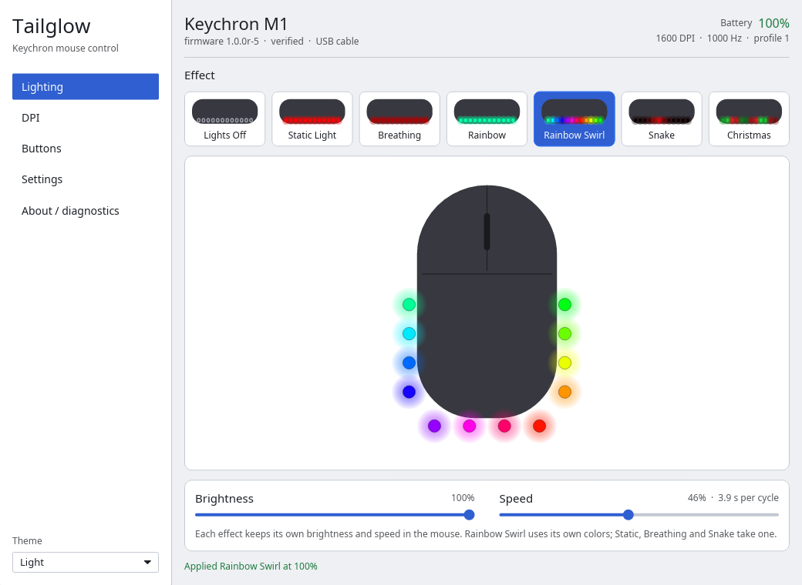 | 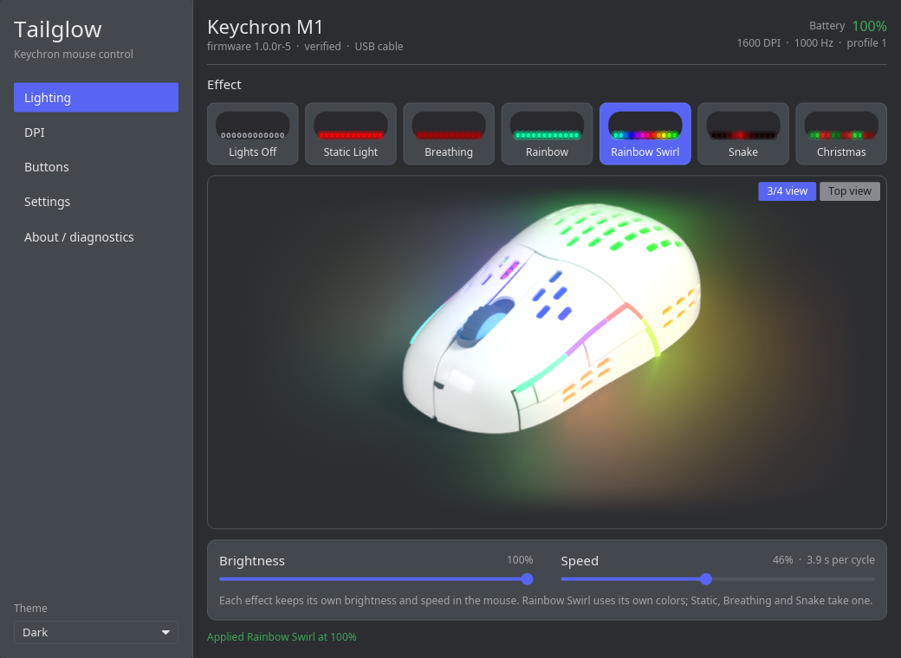 |
| 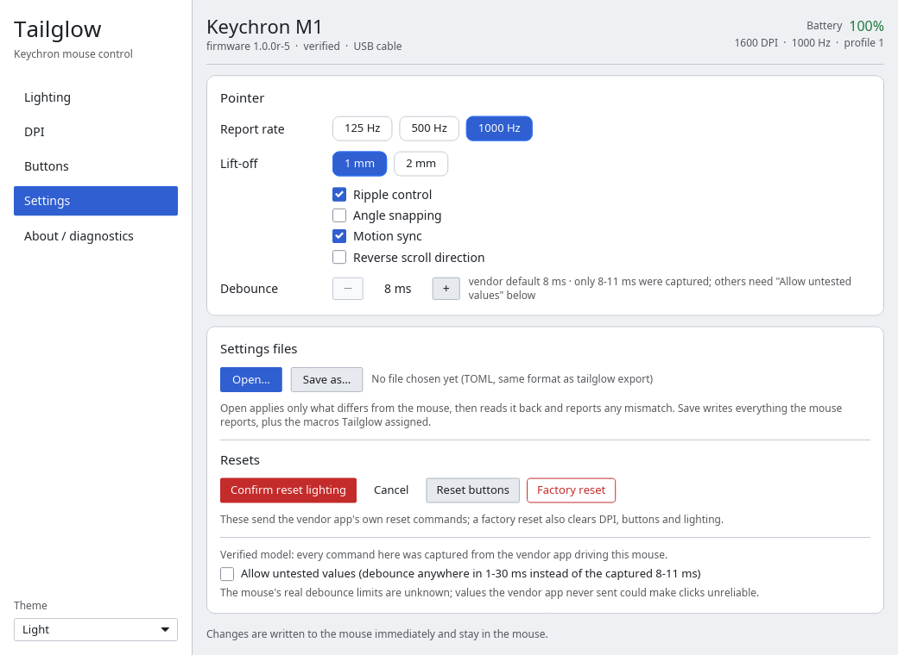 | 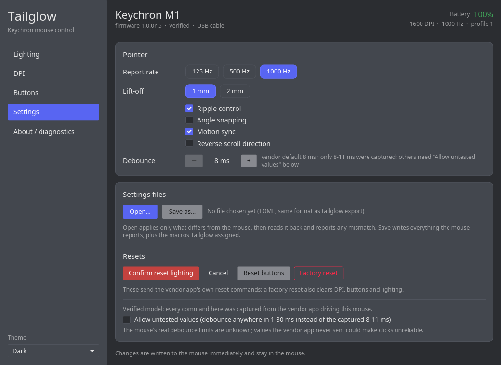 |

The Lighting page previews the effect live on a 3D render of the white M1,
with the light on its real zones (slots, wheel, light pipes) and the glow on
the desk; "3/4 view" / "Top view" switches the camera. The render is an
original made for this project (`crates/tailglow-gui/assets/render/`); other
models get a simple drawing instead.

| Static red, 3/4 view | Rainbow Swirl and Snake, top view |
|---|---|
| 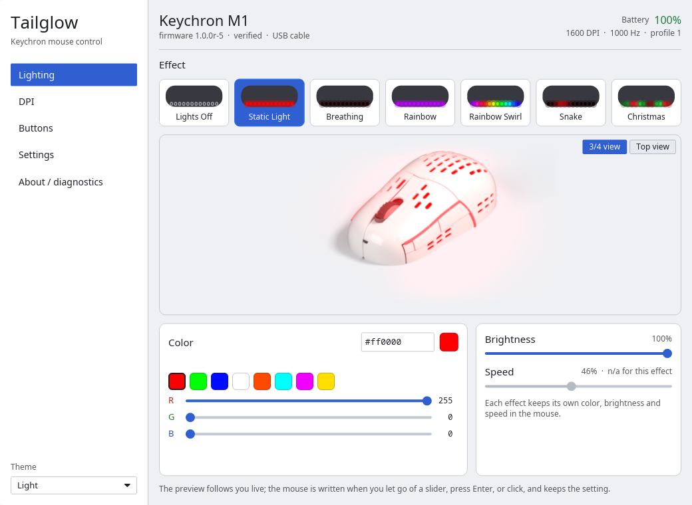 |  |
| 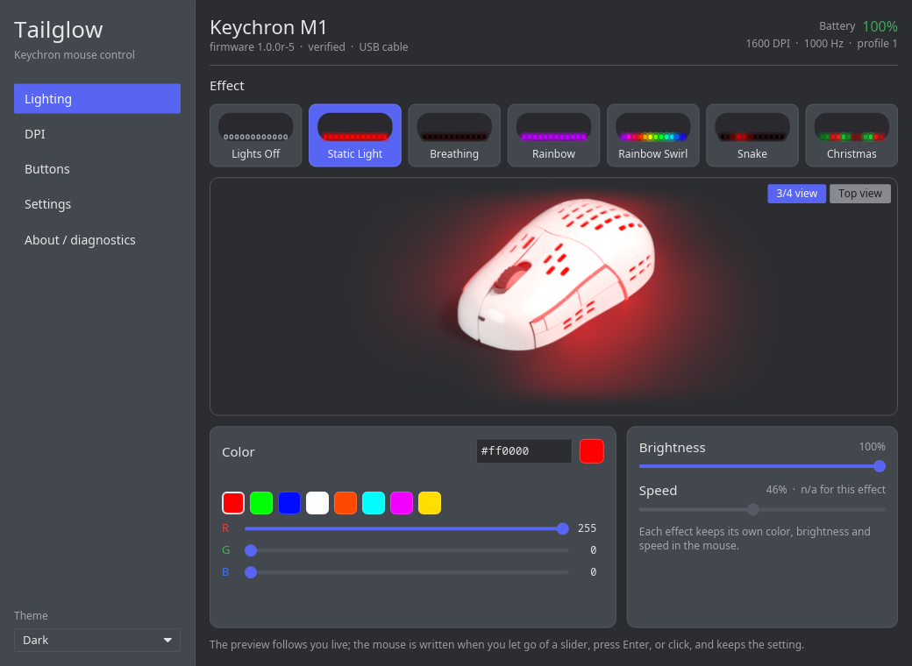 | 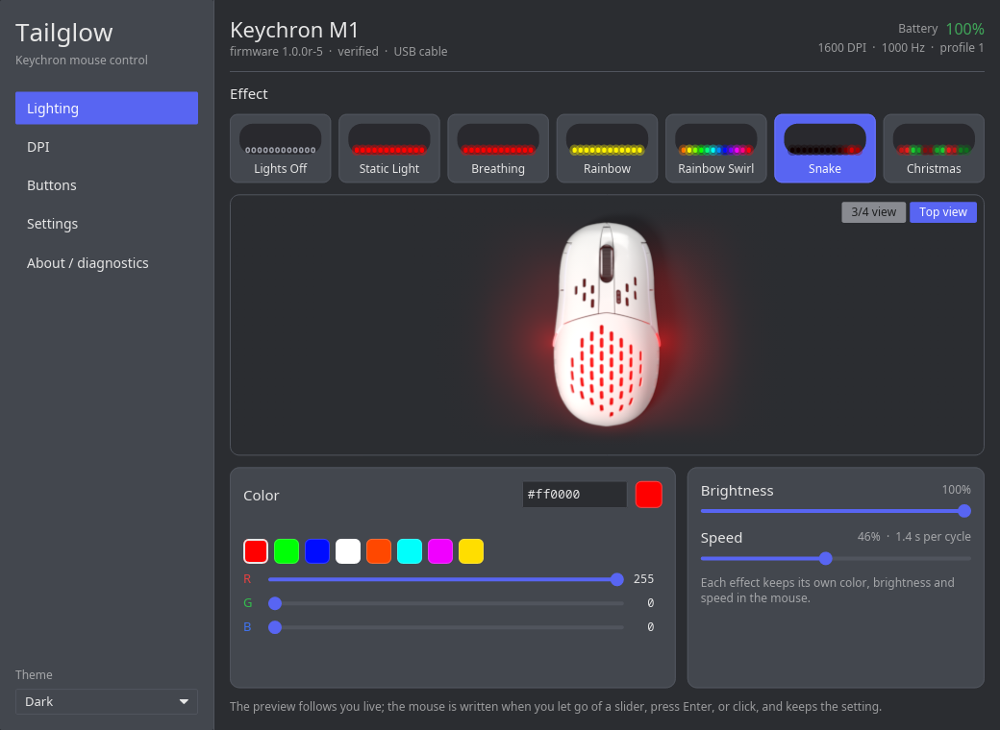 |

Over Bluetooth (fake BlueZ; `scripts/bluetooth-screenshots.sh`):

| GUI, Bluetooth only | Tray menu |
|---|---|
| 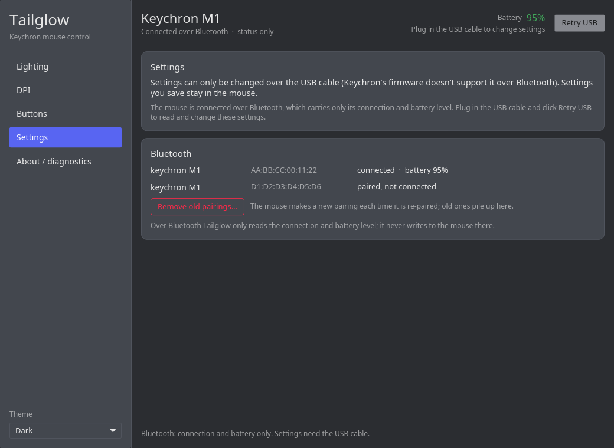 | 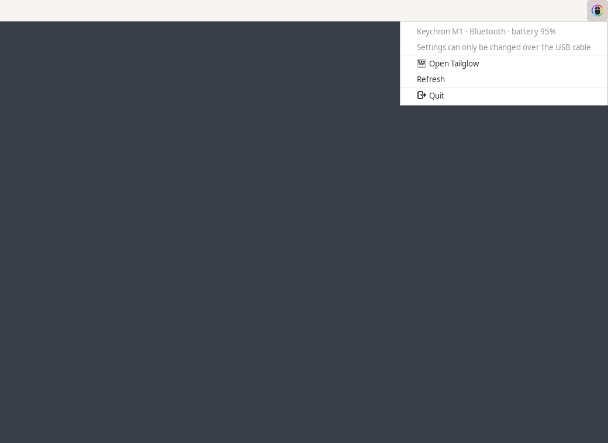 |

`scripts/theme-live-test.sh` checks the live theme switching on a private
D-Bus session bus with a fake portal (`scripts/fake-portal.py`).

## Safety

- `tailglow` only sends commands that the vendor app was seen sending in our
  captures, with the same argument layouts. There is no fuzzing, no probing of
  unknown opcodes, and no firmware or bootloader command of any kind.
- Writes take effect immediately and persist in the mouse across app restarts
  and reconnects (verified). There is no separate save step.
- Whether settings survive a power cycle, and whether each write hits flash,
  is **unknown** (not yet tested). Until it is, treat every write as possibly
  flash-backed: `tailglow` never streams values, the GUI rate-limits writes, and
  software-driven effects are deferred (`docs/SOFTWARE-EFFECTS.md`).
- Models tagged *likely* are never written to unless you opt in; models tagged
  *unknown* or *unsupported* are never opened. A node is identified from OS
  metadata (Linux: sysfs `HID_ID` and the USB `bInterfaceNumber`) **before**
  it is opened, so no report, not even a read query (which is a SET_REPORT
  too), reaches a pointer interface, an unknown device or an unsupported
  model, with or without `--device`.
- Values the vendor app was never seen sending (debounce outside 8-11 ms) need
  the same explicit opt-in as untested models.
- Factory reset (`tailglow reset factory --yes`) restores the state documented
  in `docs/PROTOCOL.md` (Rainbow, DPI 400/800/1600/3200/5000, factory button
  map). It also clears any key-pairing combination set in the vendor app.

## Protocol

`docs/PROTOCOL.md` documents every command seen, with each claim tagged
*verified*, *likely* or *unknown*. The two USB captures it is based on ship in
`testdata/` and drive the `FakeMouse` used by the test suite.

## License

Copyright 2026 Tailglow contributors.

Tailglow is free software: you can redistribute it and/or modify it under the
terms of the GNU General Public License as published by the Free Software
Foundation, either version 3 of the License, or (at your option) any later
version. It is distributed in the hope that it will be useful, but WITHOUT ANY
WARRANTY; without even the implied warranty of MERCHANTABILITY or FITNESS FOR
A PARTICULAR PURPOSE. See `LICENSE` for the full text.

Every source file carries `SPDX-License-Identifier: GPL-3.0-or-later`. All
Rust dependencies are under GPL-3-compatible licenses (MIT, Apache-2.0, BSD,
Zlib, ISC, MPL-2.0, Unicode, BSL-1.0, CC0, Unlicense, or dual-licensed with
one of these); `scripts/check-licenses.py` lists them from `cargo metadata`.

## Contributing

Own a Keychron mouse? Tell us whether it works with the
[mouse report form](https://github.com/CyberJody/tailglow/issues/new?template=mouse-report.yml);
bugs go in the [bug form](https://github.com/CyberJody/tailglow/issues/new?template=bug.yml).

See `CONTRIBUTING.md` (clean-room rule, evidence tags, tests, hardware test
script) and `docs/ADD-YOUR-MOUSE.md` if you have a Keychron mouse that is not
yet verified. Changes are listed in `CHANGELOG.md`.
